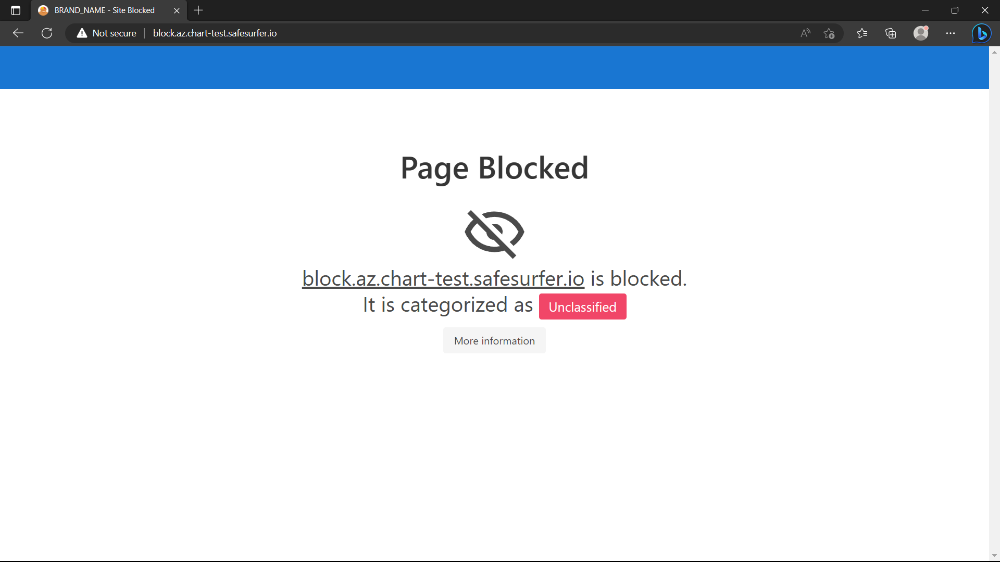

# Block Page
Setting up a block page shows your users when a website has been blocked, rather than just failing the request. With no `blockpage.domain`, the DNS answers a blocked name with `NXDOMAIN`. If you don't want that, you can host the block page, which will show a message and category for the domain in the user's browser, unless the blocked site is using HSTS or the browser otherwise expects HTTPS. Users can use the API to choose `NXDOMAIN` for their account if they prefer it.

## Using NXDOMAIN
`blockpage.enabledForUsersByDefault` defaults to `true`. Set it to `false` so accounts get `NXDOMAIN` unless they turn the block page on for themselves. Leave `domain` empty when you are not sending anyone to a page. An empty `domain` also makes the proxy answer `NXDOMAIN`, because it has no host to return.

```yaml
blockpage:
  domain: ''
  enabledForUsersByDefault: false
```

This works for either the Helm chart or `ss-config` values. A DNS server that reads the DNS feed takes this flag from the feed's database. Set it on the cluster that runs the feed, then let the DNS pick up the live update.

## Using the block page
To send blocked names to a page hosted somewhere else, set that name and leave `enabledForUsersByDefault` at its default `true`:

```yaml
blockpage:
  # Any domain you like
  domain: block.example.com
```

A hostname is returned as a CNAME. The proxy resolves that name through the recursor, so the answer includes its addresses. The name has to resolve from the recursor. An IP address is returned as an A or AAAA record instead of a CNAME.

To host the block page as part of this release, install [cert-manager](https://cert-manager.io) as described in the [ingress and cert setup](./ingress-and-cert-setup.md) guide, and enable the admin app ingress before the upgrade. The chart refuses the release with `Categorizer ingress must be enabled` until `categorizer.adminApp.enabled` and `categorizer.adminApp.ingress.enabled` are both true. The block page calls the admin app's [public search](https://safesurfer.gitlab.io/admin-app-api-docs/#tag/domains/operation/getPublicSearch) endpoint to find the category of the blocked site, at `https://` plus `categorizer.adminApp.ingress.host`. That call cannot go through the user API, because the user API enforces CORS. The admin app does not enforce CORS. Authenticated admin routes still require a username and password. `categorizer.adminApp.authIpWhitelist` limits those authenticated routes and still allows the public search the block page uses.

```yaml
categorizer:
  adminApp:
    ingress:
      enabled: true
      host: categorizer.ss.example.com
blockpage:
  enabled: true
  domain: block.ss.example.com
```

The block page certificate is self-signed. HTTPS will not be valid for visitors, because the page is served under the blocked site's name rather than under `blockpage.domain`.

The block page is not published through the shared ingress. It has its own LoadBalancer Service, so the cluster creates another external IP. The Service carries AWS load-balancer annotations, which other platforms ignore.

Deploy with `helm upgrade "safesurfer" "safesurfer/safesurfer" -f values.yaml`, then watch `kubectl get service -w` until the block page address is ready:

```
NAME                        TYPE           CLUSTER-IP     EXTERNAL-IP     PORT(S)                      AGE
safesurfer-block-page       LoadBalancer   10.0.201.163   xx.xxx.xxx.xx   80:31518/TCP,443:30125/TCP   36s
```

On a cluster with no load-balancer implementation, `EXTERNAL-IP` stays `<pending>`. The Service still has a ClusterIP. `kubectl port-forward svc/safesurfer-block-page 8080:80` reaches the page for a local check.

Create a DNS entry for `blockpage.domain` pointing at that external IP. The recursor has to be able to resolve it, or blocked queries come back as a CNAME with no address.

Once the admin app ingress has been enabled and any DNS entries have propagated, you should be able to enter the domain or IP address of your block page in your browser to view it. The default block page is unbranded and should look something like this:



You can update the category of the block page domain in the admin app to get it to show something different, but there's no requirement to.
You will want to make some branding changes to the block page before using it in production. The block page is open source, you can fork it [here](https://gitlab.com/safesurfer/block-page).

### Troubleshooting
- If the page looks blank, check the browser console to see if there was an error accessing the API.
