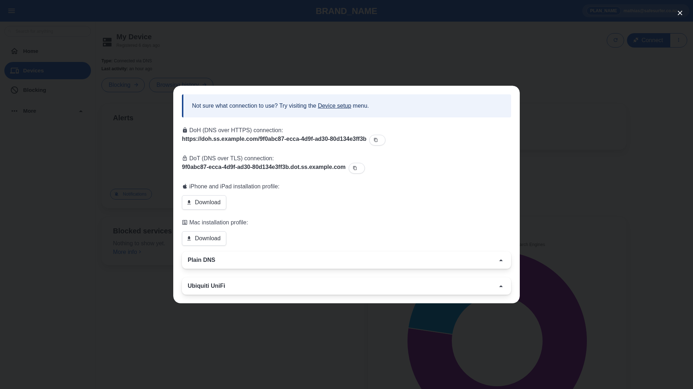

# DOH, DOT, and DOQ
DOH (DNS over HTTPS), DOT (DNS over TLS), and DOQ (DNS over QUIC) can be used to encrypt DNS requests to avoid privacy leaks over untrusted networks. In the case of Safe Surfer, they can be used to attribute requests to a source device more easily. This is done using the DNS token of the device. For DOH, the DNS token is specified in the path, e.g. `https://doh.ss.example.com/xxxxxxxx-xxxx-xxxx-xxxx-xxxxxxxxxxxx`. For DOT and DOQ, the DNS token is specified in the subdomain, e.g. `xxxxxxxx-xxxx-xxxx-xxxx-xxxxxxxxxxxx.dot.ss.example.com`.

In this guide, we will assume you've set up the DNS either in kubernetes or on servers using the `ss-config` tool.

## Configuring DOH, DOT, and DOQ
Set the following keys in your `values.yaml`, for either the Helm chart or `ss-config`. On Kubernetes these containers run inside the DNS pod, so `dns.dns` must be enabled too. `ss-config` installs each protocol as its own host service (`ss-doh`, `ss-dot`, and `ss-doq`).

```yaml
dns:
  dns:
    enabled: true
  doh:
    enabled: true
    host: doh.ss.example.com
  dot:
    enabled: true
    host: dot.ss.example.com
  doq:
    enabled: true
    host: doq.ss.example.com
```

## TLS setup

`doh`, `dot`, and `doq` each require `tls` to be configured before the DNS pod will start. The options differ for Kubernetes and `ss-config`. DOT and DOQ need a certificate that covers the host and any subdomain, because the device id is carried in the subdomain. DOQ also requires TLS 1.3.

### Kubernetes TLS
These containers do not use an ingress, so HTTP01 validation is not supported. See the [ingress and cert guide](./ingress-and-cert-setup.md) for how certificates are created for the services that do use an ingress.

Name a Secret that already contains `tls.crt` and `tls.key`. Cert-manager DNS01, or any other process, can create that Secret. This chart does not request the certificate.

```yaml
dns:
  doh:
    enabled: true
    host: doh.ss.example.com
    tls:
    - secretName: safesurfer-doh-cert
  dot:
    enabled: true
    host: dot.ss.example.com
    tls:
    - secretName: safesurfer-dot-cert
  doq:
    enabled: true
    host: doq.ss.example.com
    tls:
    - secretName: safesurfer-doq-cert
```

To embed the PEM in `values.yaml` instead, set `custom.enabled: true` and put the certificate and key under `custom.cert` and `custom.key`. One Secret can be shared by all three protocols when the names on the certificate cover each host.

DOH at `doh.ss.example.com` can use a certificate for that single name. DOT and DOQ need a wildcard for the device subdomain, for example `dot.ss.example.com` and `*.dot.ss.example.com`.

> **Warning**
> A renewed certificate does not restart the DNS pod on its own. Restart it after the certificate renews, for example `kubectl rollout restart deployment safesurfer-dns`, so DOH, DOT, and DOQ pick up the new files.

### ss-config TLS
The `ss-config` values only support `custom` as a cert option, but they also support an additional parameter, `certSync`, which periodically retrieves the public key from a host to keep the certificate valid. For example:

```yaml
dns:
  doh:
    tls:
    - custom:
        cert:
        key:
    # Comment out to disable cert sync
    certSync:
      # Hostname:port to grab the public SSL cert from
      endpoint:
      # In systemd calendar timer format
      schedule: '*-*-* 4:00:00'
  dot:
    tls:
    - custom:
        cert:
        key:
    # Comment out to disable cert sync
    certSync:
      # Hostname:port to grab the public SSL cert from
      endpoint:
      # In systemd calendar timer format
      schedule: '*-*-* 4:00:00'
```

`doq` uses the same `tls` and `certSync` keys. `certSync` checks that the new certificate matches the private key and is not expired, then applies it and restarts `ss-doh`, `ss-dot`, or `ss-doq`. On Kubernetes, `serveCertOnly` on `doh`, `dot`, or `doq` serves the certificate without answering DNS queries, which is enough for that sync.

## Domain/port setup
`ss-config` binds each protocol on the host. The `bindPort` values already place DOH, DOT, DOQ, and plain DNS so they can share an address.

On Kubernetes, DOH, DOT, and DOQ are containers in the DNS pod. They do not have their own Deployments or Services. Scale them with `dns.dns`. DOH is published on TCP 443 and DOT on TCP 853 of `dns.dns.service.tcp`. DOQ is published on UDP 853 of `dns.dns.service.udp`. Plain DNS TCP and UDP stay on their own ports of those two Services.

### Same address as plain DNS over TCP
Enable the DNS TCP Service. DOH and DOT are added to it:

```yaml
dns:
  dns:
    enabled: true
    hostNetwork: false
    service:
      tcp:
        enabled: true
        type: LoadBalancer
        port: 53
  doh:
    enabled: true
    host: secure-dns.ss.example.com
  dot:
    enabled: true
    host: secure-dns.ss.example.com
```

`kubectl get service` then shows one LoadBalancer with plain DNS TCP, DOH, and DOT:

```
NAME                                       TYPE           CLUSTER-IP     EXTERNAL-IP     PORT(S)                                    AGE
safesurfer-dns-tcp                         LoadBalancer   10.0.93.39     xx.xx.xxx.xx    53:31978/TCP,443:30879/TCP,853:30384/TCP   24m
```

Kubernetes still cannot put UDP and TCP on the same Service. Plain DNS over UDP, and DOQ, use `dns.dns.service.udp`. To serve plain DNS on both UDP and TCP from the node address, use host networking below.

### Host networking
To serve plain DNS, DOH, DOT, and DOQ on the node, use the host networking mode from the [getting started](./getting-started.md) guide:

```yaml
dns:
  dns:
    enabled: true
    hostNetwork: true
    service:
      tcp:
        enabled: false
      udp:
        enabled: false
    sidecarContainers:
      healthCheck:
        bindPort: 53531
        httpSecret:
          enabled: true
          secret: generate-a-strong-secret
  doh:
    enabled: true
    host: secure-dns.ss.example.com
  dot:
    enabled: true
    host: secure-dns.ss.example.com
  doq:
    enabled: true
    host: secure-dns.ss.example.com
```

Then update the load balancing rules for the node pool as described in the [getting started](./getting-started.md) guide. The containers listen on their `bindPort`, and the load balancer publishes the usual public port:

- DOH listens on `8443` and has an HTTP health check on `8888`. Publish it as TCP `443`.
- DOT listens on `8358` and has an HTTP health check on `8889`. Publish it as TCP `853`.
- DOQ listens on `8530` and has an HTTP health check on `8891`. Publish it as UDP `853`.

The HTTP health checks use GET and the path `/`. Allow `8443`, `8358`, and `8530` through the firewall. A load balancer that probes the health ports also needs `8888`, `8889`, and `8891`.

On kind or minikube with `hostNetwork: true`, the DNS Services stay off, so there is no LoadBalancer address. The sidecars listen on the node at those bind ports. A DoH query to `https://<node>:8443/dns-query` and a DoT query to port `8358` are enough to confirm the containers are answering. DOQ's health check on port `8891` returns `ok` when its own QUIC query succeeds.

## Testing
Once you've set up DOH, DOT, or DOQ using any of the above methods, you're ready to test.

If you've set up the API and frontend as part of an earlier guide, refresh the frontend after `doh.host` and `dot.host` are set. Open a DNS device on the Devices page and select `Connect`. The dialog shows the DoH URL (the DNS token is the path) and the DoT name (the DNS token is the subdomain), plus iPhone/iPad and Mac profile downloads:



You can test DOH by putting the URL into your browser settings under `Use secure DNS`. This is supported by Firefox, Edge, and Chrome. You can test DOT by using [Private DNS](https://support.google.com/android/answer/9654714?hl=en#zippy=%2Cprivate-dns) on Android or the [kdig](https://www.knot-dns.cz/docs/2.6/html/man_kdig.html) tool with the `+tls` option.

You can test DOH on Apple devices by configuring the `.mobileconfig` file download. Add something like the following to your `values.yaml`

```yaml
api:
  devices:
    appleMobileConfig:
      iOs:
        identifier: com.example.profile
        doh:
          identifier: com.example.profile.dnsSettings
          addresses:
          - 'xx.xx.xx.xx'
          - 'xx.xx.xx.xx'
          host: doh.ss.example.com
      macOs:
        identifier: com.example.profile
        doh:
          identifier: com.example.profile.dnsSettings
          addresses:
          - 'xx.xx.xx.xx'
          - 'xx.xx.xx.xx'
          host: doh.ss.example.com
  strings:
    langs:
      en:
        strings:
          apple_mobileconfig_display_name: 'Secure DNS'
          apple_mobileconfig_description: 'Use DNS filtering and logging, as well as other settings to make browsers use and enforce this filtering.'
          apple_mobileconfig_doh_display_name: 'Secure DNS'
          apple_mobileconfig_doh_description: 'Installs an encrypted DNS link'
          apple_mobileconfig_filename: 'DNS.mobileconfig'
```

`doh: null` (the chart default) leaves the encrypted-DNS payload out of the file. Setting `doh.identifier` turns it on. `addresses` is the list of IPs for that host. The same `doh` block can be set on `iOsSupervised` and `iOsSupervisedDisableFactoryReset`. Supervised profiles can also set `prohibitDisablement: true`.

Browser payloads (Chrome, Edge, Firefox, and the others listed under `api.devices.appleMobileConfig` in the chart values) stay out of the file while they are `null`. Set `identifier` on a browser key to include it. Apple Books uses the same pattern under `appleBooks`.

> **Warning**
> Be extremely careful to maintain control of every IP under `addresses`. Those addresses are where the device will send DNS.

The Connect dialog always shows Download for iPhone and iPad (`profile-name` `iOs`) and for Mac (`macOs`). After this config is deployed, those files include the DoH settings. Until `doh` is set, the download still succeeds and the file has no DNS payload.
