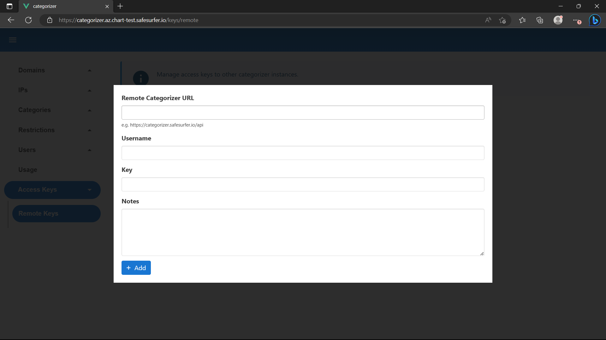
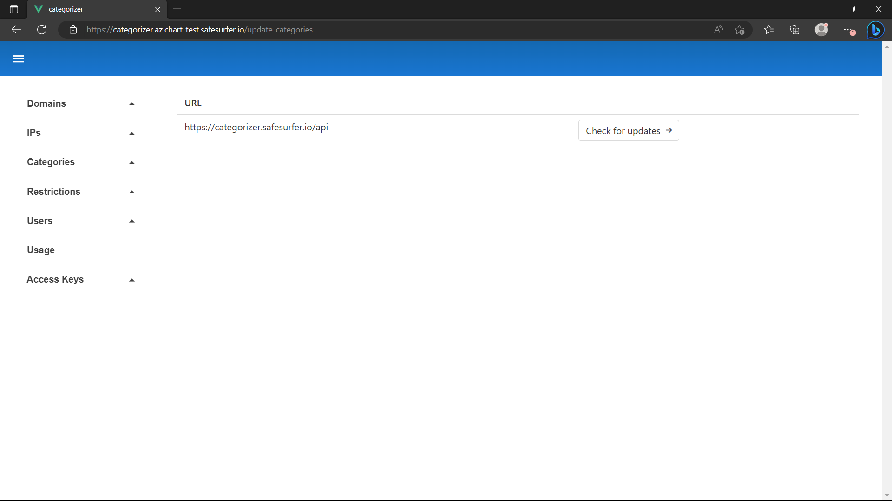
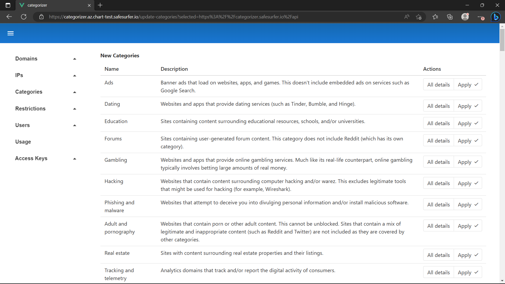
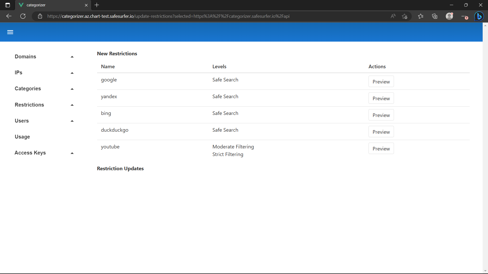
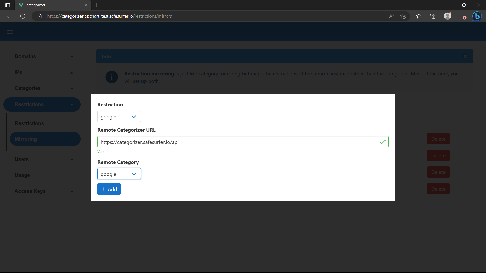
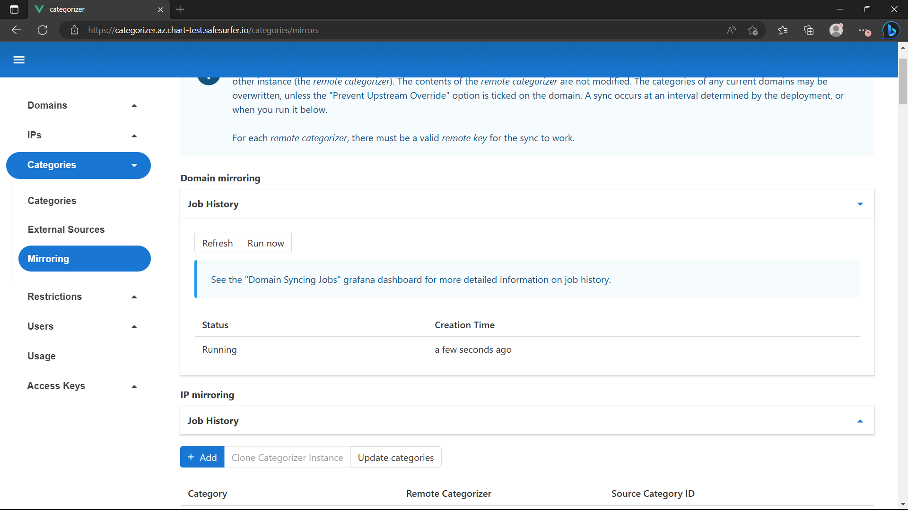

# Domain mirroring
Domain mirroring can be used to sync changes to domain categories from one categorizer instance to another. By hooking up domain mirroring from your instance to ours, you can avoid worrying about building your own domain database. Using the `Prevent Upstream Override` option on domains, you can maintain control over certain domains.

To test domain mirroring, you will need an API key to another categorizer instance. To get one to ours and use our domain database, contact us at [info@safesurfer.io](mailto:info@safesurfer.io).

To begin, access the admin app as described in the [getting started](./getting-started.md) guide. Then, navigate to the `Access Keys -> Remote Keys` page and hit `Add`. Enter the URL, username, and key for the categorizer instance to pull from. The URL field suggests `https://categorizer.safesurfer.io/api`.



Now, go to the `Categories -> Mirroring` page. Two dialogs warn that domain mirroring and IP mirroring are not enabled yet. Dismiss them. `Run now` stays disabled until the cronjobs below are enabled. Hit `Update categories`.

If no remote key has been added, that page says `No remote categorizers have been added. Nothing to update.` After a key exists, you get one row per remote categorizer:



Hit `Check for updates` and you should see a list of the remote categorizer's categories. Add any that you wish to use. You will want to avoid the `Always Allowed` category and add your own instead.



`Clone Categorizer Instance` copies every category from a remote categorizer. It is only available before this instance has any categories. A deployment that already has categories uses `Update categories` instead.

Repeat the process for restrictions on the `Restrictions -> Mirroring` page, using `Update restrictions`.



If you already added a `Google` restriction as part of this guide, add that mapping by hand instead of through the update menu:




If there are any domains that belong to a category with mirroring set up that you don't want to change, make sure to search for them now and tick the `Prevent Upstream Override` option.

Now let's open our `values.yaml` and enable any mirroring cronjobs we want to run. For example, to sync both domains and IPs, overwrite the following keys:

```yaml
categorizer:
  mirroring:
    enabled: true
  ipMirroring:
    enabled: true
    login:
      accessKey: generate-a-strong-password
```

`ipMirroring.login.accessKey` is a password for this categorizer, used by the IP mirroring job. It is not the remote key from the admin app. Helm will not install IP mirroring without it. Domain mirroring does not take an access key here. History entries from that job use `categorizer.mirroring.login.username`, which defaults to `Upstream-Categorizer`.

Then upgrade the release. On `Categories -> Mirroring`, `Run now` is enabled.



The first domain sync can take 2-3 days. Later runs finish in minutes or seconds. The job timeout is `categorizer.mirroring.timeout`, which defaults to `168h`. A new sync does not start while one is still running.
