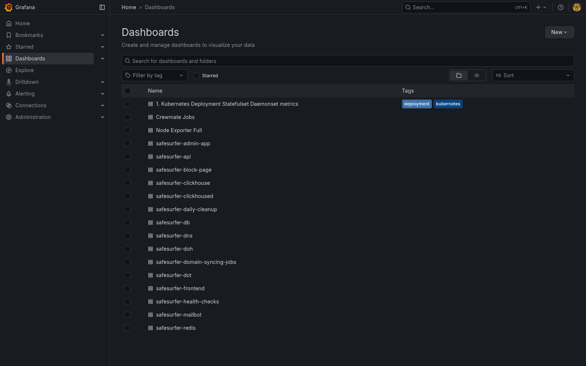
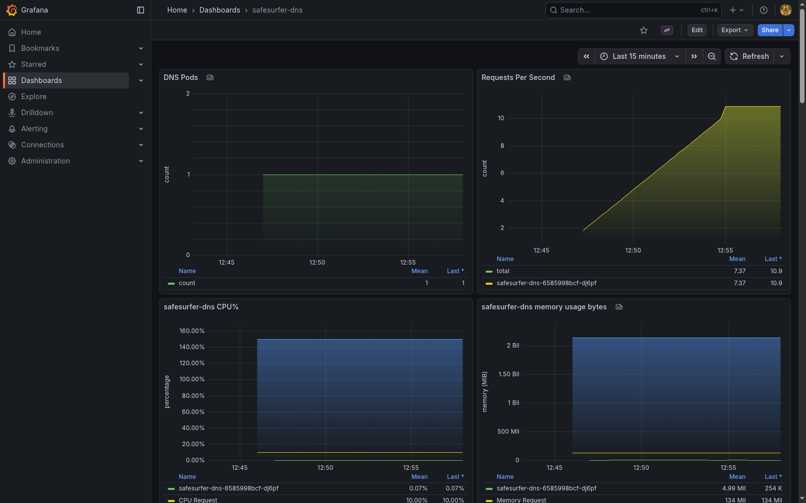
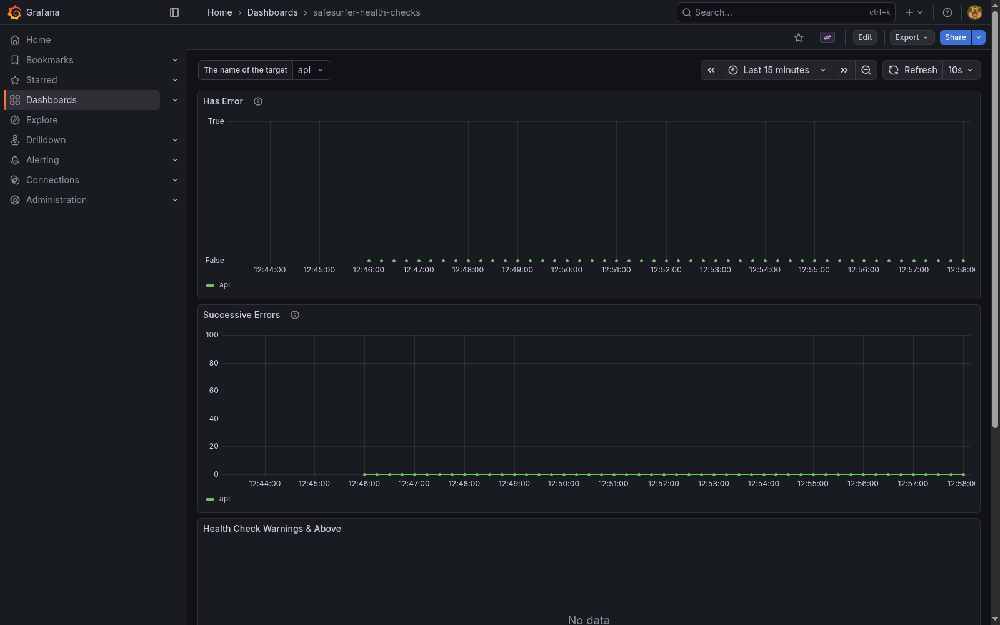
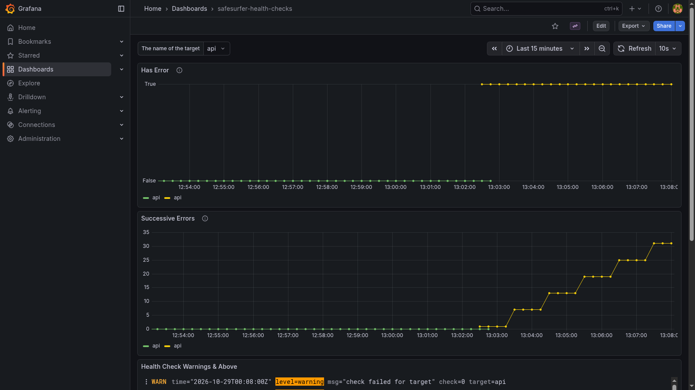

# Monitoring
This chart comes packaged with [Grafana](https://grafana.com/) dashboards that you can use to observe the deployments. Grafana pulls data from the [Prometheus](https://prometheus.io/) and [Loki](https://grafana.com/oss/loki/) databases. You can also set up alerts using Prometheus. As part of this guide, we'll install the above tools in the cluster and enable the Safe Surfer dashboards. You can complete this guide at any point during the other guides, or not at all.

## Installing the tools
See the [Monitoring Stack](https://gitlab.com/safesurfer/monitoring-stack) repo for how to install the tools. They may already be installed in your cluster, in which case you don't need to do anything.

The Loki example in that repo sets `loki.persistence.storageClassName` to `faster`. Change that to a StorageClass that exists before installing. On kind the default class is `standard`, and a missing class leaves the Loki volume Pending. The Grafana and Loki charts currently print a deprecation warning; the releases still become Ready.

## Enabling the dashboards
> **Warning**
> With this setup, the monitoring tools are installed into the `monitoring` namespace. The dashboards are installed into that same namespace, not the `--namespace` that you provide to Helm. You can change this behavior by leaving `monitoring.namespace` blank and deploying Grafana into your release's namespace.

Add the following to your `values.yaml`:

```yaml
monitoring:
  enabled: true
  namespace: monitoring
```

Then, upgrade your deployment:

```sh
helm upgrade "safesurfer" "safesurfer/safesurfer" -f values.yaml
```

Grafana should now be loaded with the dashboards. The instructions linked above show how to access grafana using port-forwarding, but you can also enable an ingress for convenience under `monitoring.ingress`. See [ingress and cert setup](./ingress-and-cert-setup.md) for more details.

The chart does not install Grafana. It writes one ConfigMap per enabled component into `monitoring.namespace` (or the release namespace when that is blank). The Grafana sidecar from the monitoring stack picks those up. Dashboard names follow the release, for example `safesurfer-dns` and `safesurfer-health-checks`. Enabling DNS, DoH, or DoT adds those dashboards. DoQ does not have one. The API dashboard set includes mailbot even when mailbot itself is disabled. The Kubernetes and Node Exporter dashboards in the picture below come from the monitoring stack, not from this chart.

After accessing Grafana through either method, open Dashboards. The Safe Surfer dashboards are listed with the ones the monitoring stack installed (Kubernetes deployment metrics, Node Exporter, and Crewmate Jobs). They are in Grafana's default folder:



The `safesurfer-` dashboards monitor the Safe Surfer deployments specifically, while the others added by Grafana are useful for monitoring the cluster in general.

New dashboards are automatically added as you enable parts of the chart. For example, if you've enabled the DNS on kubernetes, the DNS dashboard shows request rate, CPU, and memory for the recursor:



The response-time panel further down that dashboard is the old `grafana-piechart-panel` plugin. The monitoring stack still sets `GF_INSTALL_PLUGINS=grafana-piechart-panel`. Current Grafana downloads that plugin and then refuses to load it, because Angular plugins are disabled, so the panel says No data. The `pdns_recursor_x_ourtime*` series are still in Prometheus. The other panels do not use that plugin.

### Troubleshooting
- If you've deployed the monitoring stack to the monitoring namespace (as this example shows), the tls configuration may not work as you expect, since the ingress will also be created in the `monitoring` namespace. Therefore, you cannot reference a secret created in the release namespace.

## Alerting
You can use prometheus alerts to alert for any metrics in the cluster. A useful deployment for this is `healthChecks`, which generates prometheus metrics for uptime checks that you define. A Grafana dashboard also visualizes the status over time. To try it out, add the following to your `values.yaml`, updating the URLs/addresses to point to your own deployment:

```yaml
healthChecks:
  enabled: true
  spec:
    targets:
    # Comment out targets for anything you haven't created yet
    # HTTP health checks are useful for checking whether the API is running properly.
    - name: api
      interval: '*/10 * * * * *' # Every 10 seconds
      healthChecks:
      - type: HTTP
        spec:
          url: https://api.ss.example.com
          method: GET
          timeout: 5s
    # DNS health checks for whether the DNS is functioning properly.
    # Health checks for secure DNS are also available, see the full values.yaml
    # file for all examples.
    - name: plain-dns
      interval: '*/5 * * * * *' # Every 5 seconds
      healthChecks:
      - type: DNS
        spec:
          address: '0.0.0.0' # DNS resolver to query
          port: 53 # 53 is default
          proto: udp # udp is default
          domain: internetbadguys.com # domain to look up
          # Optional. Compared to the addresses LookupHost returns. A block that
          # is only a CNAME, with no address, will not match an entry here.
          # Leave this out to accept any successful lookup.
          expectedIPs:
          - '0.0.0.0'
          timeout: 2s
      # Also test ipv6 - or comment out if you're not using ipv6
      - type: DNS
        spec:
          address: '[0::0]' # IPv6 must be in square brackets
          proto: tcp
          domain: google.com
          timeout: 5s
```

An HTTP check fails when the response is not 2xx, including 401 and 404. A connection error or a timeout fails it as well. Point it at a URL that returns 200 when the service is up.

Then, upgrade the deployment. You should now see the health checks pod:

```
NAME                                             READY   STATUS      RESTARTS   AGE
safesurfer-health-checks-668c9fb88d-gkb9g        1/1     Running     0          116s
```

There should also be a new Grafana dashboard named `safesurfer-health-checks`, which shows whether your targets are currently healthy, how many successive failures they have, and the logs, which show why they fail. All going well, it should look something like this:



The pod serves Prometheus metrics on port 2112. The two series are `ss_status_is_error` (1 when the target is unhealthy) and `ss_status_successive_errors`, both labeled with `target`. The Service port 80 is the status HTTP port, not the metrics port. Prometheus adds its own `job` label from the scrape config. With the prometheus-community chart the same pod is scraped twice: `job="kubernetes-service-endpoints"` (labeled `service`) and `job="kubernetes-pods"` (labeled `app`). The health-checks dashboard filters on `app`, so it reads the pod scrape. The rule below matches the endpoints scrape. Drop that matcher if your stack uses a different job name. The default rule group is evaluated once a minute, so the alert appears on the evaluation after the sixth failure, not at the moment of that failure. A series from a deleted pod stays in Prometheus until it goes stale, about five minutes, and can keep the alert firing after the live target is healthy again.

To actually get alerted, we'll need to update our prometheus deployment. Add the following to the Prometheus values you already installed with, and upgrade with that same file. Prometheus doesn't alert you on its own, but can be configured to work with a large number of alerting providers. The `receivers` array is where you define this. For the possible configurations, see the [prometheus docs](https://prometheus.io/docs/alerting/latest/configuration/#receiver).

The receiver in the snippet is commented out, and the route points at `safesurfer-team`. Alertmanager rejects that config with `undefined receiver "safesurfer-team" used in route`. Uncomment a receiver and fill in a real integration before upgrading. An upgrade that uses only this snippet, and not the monitoring-stack values, also replaces the release's other settings. The resource block below asks for 1500Mi; the monitoring stack's Prometheus values ask for 2500Mi and a 16Gi volume.

```yaml
server:
  resources:
    limits:
      cpu: 500m
      memory: 1500Mi
    requests:
      cpu: 100m
      memory: 1500Mi
serverFiles:
  alerting_rules.yml:
    groups:
    - name: dns
      rules:
      # Alert for any target that is unhealthy 6 times in a row. This would equate to being down for a minute
      # if the health check runs every 10 seconds.
      - alert: TargetFrequentlyUnhealthy
        expr: ss_status_successive_errors{job="kubernetes-service-endpoints"} > 5
        for: 0m
        labels:
          severity: critical
        annotations:
          summary: "Target {{ $labels.target }} unhealthy"
          description: "{{ $labels.target }} has been unhealthy for the last {{ $value }} checks"
      # Alert if the health check pod is down for more than a minute
      - alert: MonitoringProblem
        expr: absent(ss_status_is_error)
        for: 1m
        labels:
          severity: critical
        annotations:
          summary: "Health check not found"
          description: "No health check update for 1 minute"
alertmanager:
  config:
    route:
      receiver: safesurfer-team
      continue: false
      group_wait: 10s
      group_interval: 5m
      repeat_interval: 1h
    receivers:
    ## Define your receivers here:
    # - name: safesurfer-team
    #   opsgenie_configs:
    #   - api_key: example-api-key

```

Then upgrade your prometheus deployment with the values file you added this to. According to the monitoring stack repo that is `helm -n monitoring upgrade prometheus prometheus-community/prometheus -f values.yaml`. With a webhook receiver pointed at a closed port, the alert still shows in Prometheus and Alertmanager, and Alertmanager logs that the notification was refused. A real receiver replaces that URL.

To test our alerting system, we'll have to break something! Update your `values.yaml` to create a health check that won't succeed. For example, modify the URL/address; then upgrade the deployment. We should now see something like this on the Grafana health checks dashboard:



Your chosen alerting system should now be alerting you.

### Troubleshooting
- Not being alerted? Check prometheus server and alert manager logs for issues with prometheus configuration.

### Creating a status page
You can expose the current health status for your targets publicly over HTTP, which is useful for creating an automated status page. To do this, enable the `http` section and configure the ingress:

```yaml
healthChecks:
  http:
    enabled: true
    ingress:
      enabled: true
      host: status.ss.example.com
      tls:
        http01: true
        # Or other TLS config
```

Kind and other clusters without an ingress can skip that block. Enable `healthChecks.http` and port-forward the service instead:

```sh
kubectl port-forward svc/safesurfer-health-checks 8080:80
```

After the certificate and ingress are ready, or the port-forward is up, you can query the current status of particular targets:

```sh
$ curl https://status.ss.example.com/healthy?target=api
false
```

This API returns `true` or `false` for whether the target is currently healthy. An unhealthy target returns status `500`. A healthy target returns status `200`. An unknown target name returns `404` and the body `Bad target`. In the example above the target is unhealthy, because the previous step deliberately broke it. After the health check is pointed at a URL that returns 2xx again, the same query returns:

```sh
$ curl https://status.ss.example.com/healthy?target=api
true
```

## Common monitoring tasks
### API Abuse
Using the [Loki](https://grafana.com/oss/loki/) API, you can check if a particular IP addresses are spamming a particular API endpoint, or the API in general. This may be accidental, or deliberate abuse such as a DDOS attempt or password cracking. 

> **Note**
> The API includes built-in protection against password cracking if you set up `api.accounts.forceEmailOtpOnUnknownIpField`, since the auth endpoint will always return a 200 status code and an email OTP ID when the request is from an unknown IP address, city, or region.

To start off, set some variables:

```sh
# The route of the API endpoint you want to query, or blank for all
ROUTE="/v2/user/auth/token"
# The namespace of your deployment
NAMESPACE="default"
# The name of your helm release
RELEASE_NAME="safesurfer"
# Nanoseconds since the epoch. Loki accepts a timestamp in seconds and then matches nothing.
# One hour ago:
START_TIME="$(($(date +%s) - 3600))000000000"
# Max amount of logs to return. 5000 is the maximum you can query from loki by default.
LIMIT="5000"
```

Then, port-forward loki in a separate terminal. The command for the default installation would look like this:

```sh
$ kubectl -n monitoring port-forward svc/loki 3100:3100
```
```
Forwarding from 127.0.0.1:3100 -> 3100
Forwarding from [::1]:3100 -> 3100
```

Then, run the query and save it to a temporary file:

```sh
QUERY_PARAM=$(printf "{app=\"${RELEASE_NAME}-api\", namespace=\"${NAMESPACE}\"} |= \"${ROUTE}\"" | jq -sRr @uri)
curl "http://localhost:3100/loki/api/v1/query_range?start=$START_TIME&limit=$LIMIT&query=$QUERY_PARAM" > /tmp/ss-query.json
```

Then, generate a histogram of the results. Each API line is a logrus record with `userIp=` set to the address the API attributed to the caller (`directIp=` is the immediate connection). The client address is not the last field on the line. A route that nothing has called returns an empty file. Leave `ROUTE` empty, or set it to a path that is in the logs.

```sh
jq -r '.data.result[].values[][1]' /tmp/ss-query.json | grep -oE 'userIp=[0-9a-fA-F.:]+' | cut -d= -f2 | sort | uniq -c
```

The result will look something like this, where the number on the left is the amount of times the IP address requested that API endpoint:

```
      1 xx.xxx.xxx.xxx
     15 xx.xxx.xxx.xxx
```
